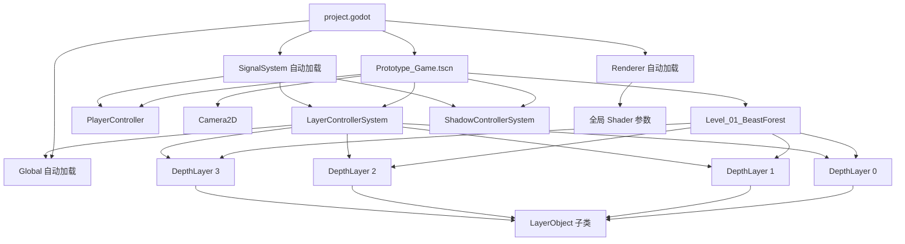

# PICTOUR 项目架构说明

> 文档日期：2026-10-14  
> 对应项目状态：`main` 分支，Godot 4.7.2 版本  
> 本文以当前代码和场景的实际实现为准，而非仅依据早期策划案或开发日志。

## 1. 项目概览

PICTOUR 是一款使用 Godot 4 开发的 2.5D 平台跳跃解谜游戏。项目最核心的机制是将“物理世界中的真实状态”和“玩家在屏幕上看到的状态”拆分开来：

- 物体根节点、碰撞体和所属物理图层保存真实位置、尺寸与碰撞关系；
- `VisualRoot` 根据当前景深槽位计算显示缩放和视差位置；
- 玩家可以轮换整套景深图层，也可以将一个物体转换到另一个图层；
- 物体换层时会改变真实位置、真实尺寸和碰撞层，但尽可能保持换层瞬间的屏幕外观不变；
- 整体图层轮换时，物体的物理归属不变，只改变其视觉景深槽位和玩家当前参与碰撞的物理层。

当前项目已经具备可玩的核心机制和第一关白模，但仍处于原型/白模阶段。正式角色动画、粒子、灯光、镜头反馈、场景转场、声音、完整 UI、存档与正式关卡流程尚未建立。

### 1.1 技术配置

| 项目项 | 当前配置 |
|---|---|
| Godot 版本 | `4.7.2-stable` |
| 主场景 | `res://Prototype_Game.tscn` |
| 窗口基准尺寸 | 1280 × 720 |
| 拉伸模式 | `canvas_items`，宽高比 `expand` |
| 渲染器 | Mobile Renderer |
| Windows 图形驱动 | D3D12 |
| 3D 物理后端 | Jolt（项目主体实际使用 2D 物理） |
| 当前关卡 | `Level/Level_01_BeastForest.tscn` |

### 1.2 当前图层参数

默认参数定义在 `Level/Level.gd`：

```text
layer_count = 4
layer_scale = 0.8
current_layer_index = 1
```

由此得到当前四个视觉槽位的缩放倍率：

| 槽位 slot | 相对位置 | 显示倍率 |
|---:|---|---:|
| 0 | 前景 | 1.25 |
| 1 | 当前关卡层 | 1.0 |
| 2 | 中/后景 | 0.8 |
| 3 | 更远后景 | 0.64 |

`README.md` 中的 `1.3333 / 1.0 / 0.75 / 0.5625` 是较早版本的数据，当前代码实际使用上表数值。

## 2. 总体架构

项目可以分为五个主要层次：

1. **启动与全局状态层**：`project.godot`、`Global.gd`、`Signal.gd`、`Renderer.gd`；
2. **系统协调层**：`Layer_Controller_System.gd`、`Shadow_Controller_System.gd`；
3. **场景与景深层**：`Level.gd`、`Depth_Layer.gd`；
4. **对象与玩法组件层**：`Layer_Object.gd` 及所有具体物体、玩家脚本；
5. **画面表现层**：三个 CanvasItem Shader、`CanvasGroup` 图层后处理和运行时选择描边。



## 3. 两套“层”的概念

这是项目中最重要的架构约定。

### 3.1 `layer_id`：物理图层身份

`DepthLayer.layer_id` 是图层固定的物理身份，通常为 0～3。它决定该图层中物体使用 Godot 的哪一位 `collision_layer` 和 `collision_mask`。

- `layer_id = 0` 对应 Godot 碰撞层第 1 位；
- `layer_id = 1` 对应第 2 位；
- 以此类推。

物体在 `LayerObject.update_layer_slot()` 中，将碰撞层和遮罩设置为 `owner_layer.layer_id + 1`。玩家的 `collision_group` 也使用 1～4 的同一套编号。

### 3.2 `slot`：视觉景深位置

`DepthLayer.slot` 表示该图层当前处于哪个视觉景深槽位。它会在整套图层轮换时变化，并决定：

- 图层的显示缩放；
- 物体相对于相机的视差位置；
- 图层的 Z 排序；
- 前景/后景滤镜强度；
- 哪个物理层当前位于玩家可行动的关卡层。

### 3.3 为什么必须分开

整套图层轮换只修改每个 `DepthLayer.slot`，不修改 `layer_id`；同时玩家切换到此刻占据当前关卡槽位的物理碰撞组。

单个物体换层则相反：物体会被 `reparent()` 到另一个 `DepthLayer`，从而改变它的物理归属；目标图层的 `slot` 用于计算换层后的尺寸与位置。

## 4. 启动流程与主场景

### 4.1 自动加载

`project.godot` 注册了三个 Autoload：

| 名称 | 脚本 | 作用 |
|---|---|---|
| `Global` | `System_Script/Global.gd` | 全局配置、场景节点引用、关卡内持久状态、简易对话显示 |
| `SignalSystem` | `System_Script/Signal.gd` | 全局输入、系统信号、影子布尔运算空闲计时 |
| `Renderer` | `System_Script/Renderer.gd` | 全局渲染参数并同步给 RenderingServer |

### 4.2 主场景结构

`Prototype_Game.tscn` 当前结构为：

```text
Node2D
├─ Level                 # Level_01_BeastForest.tscn
├─ Player                # Player.tscn
├─ Camera                # Camera2D
├─ LayerControllerSystem # Layer_Controller_System.gd
└─ ShadowControllerSystem# Shadow_Controller_System.gd
```

当前主场景中的玩家出生点为 `(-17016, 1236)`，并临时将 `air_jump_count` 设置为 `100`，用于快速浏览白模；玩家组件默认值仍为 `0`。

### 4.3 初始化调用路径

```text
启动 Prototype_Game.tscn
└─ LayerControllerSystem._ready()
   ├─ Global.discover_scene_nodes(主场景根节点)
   │  ├─ 递归找到 PlayerController、Camera2D、Level
   │  ├─ Level.write_to_global()
   │  ├─ 收集 Level 的四个直接 DepthLayer 子节点
   │  ├─ 校验层数、槽位唯一性和当前关卡层
   │  ├─ 将玩家碰撞组对齐到 current_layer_index + 1
   │  └─ Global.remember_player_state() 记录初始检查点
   ├─ Renderer.apply_settings()
   ├─ 连接 SignalSystem.layer_cycle → cycle()
   └─ 连接 SignalSystem.layer_change → transfer()
```

## 5. 目录与文件清单

`.uid` 文件由 Godot 为对应资源维护稳定资源标识。它们不包含业务逻辑，下表不逐个重复解释。

### 5.1 根目录

| 文件 | 作用 |
|---|---|
| `project.godot` | Godot 项目配置、输入映射、Autoload、渲染与全局 Shader 参数 |
| `Prototype_Game.tscn` | 当前可运行主场景，组合关卡、玩家、相机和两个系统控制器 |
| `README.md` | 项目入口说明、基础操作和早期状态概览 |
| `图层转换平台解谜游戏策划案.md` | 全局玩法与机制策划 |
| `神兽森林关卡策划案.md` | 第一关的关卡与叙事设计 |
| `.editorconfig` | 编辑器文本格式约定 |
| `.gitattributes` | Git 属性配置 |
| `.gitignore` | Git 忽略规则 |

### 5.2 `System_Script/`

| 文件 | 作用 |
|---|---|
| `Global.gd` | 全局运行状态、场景节点发现、图层参数、检查点、收藏/道具账本、简易对话 UI |
| `Signal.gd` | 输入路由、对象点选、图层信号、无人机/鹰眼信号、影子布尔空闲触发 |
| `Renderer.gd` | 保存全局画面参数并写入全局 Shader uniform |
| `Layer_Controller_System.gd` | 相机跟随、全图层视觉更新、单物体换层验证、换层碰撞检测及成功/阻挡反馈触发 |
| `Shadow_Controller_System.gd` | 收集投影、执行多边形差集、将承影物体替换成切割碎片 |

### 5.3 `Component/Layer/`

| 文件 | 作用 |
|---|---|
| `Depth_Layer.gd` | `DepthLayer` 类；管理 `layer_id`/`slot`、整层滤镜、Z 排序和子物体视觉更新 |
| `Depth_Layer.tscn` | `CanvasGroup` 图层模板，挂载景深滤镜材质并包含一个默认 `Ground` |

### 5.4 `Component/Object/`

| 文件 | 作用 |
|---|---|
| `Layer_Object.gd` | 所有景深物体的抽象基类，并统一实现选择描边、鹰眼和物体换层动效 |
| `Box/Box.gd` | 可搬运箱子状态，搬起时冻结、禁用碰撞和换层 |
| `Box/Box.tscn` | `RigidBody2D` 箱子场景 |
| `Fan/Fan.gd` | 风区、风力施加、开关、同层碰撞同步 |
| `Fan/Fan.tscn` | 风扇本体、`WindArea` 与调试风区显示 |
| `Goal/Goal.gd` | 空的 `Goal` 类型声明，目前未接入完成判定 |
| `Goal/Goal.tscn` | 目标物白模场景；当前实际挂载 `Box.gd`，并未挂载 `Goal.gd` |
| `Ground/Ground.gd` | 空的 `Ground` 类型声明，行为完全继承 `LayerObject` |
| `Ground/Ground.tscn` | 每个 `DepthLayer` 默认包含的静态地面模板 |
| `Pickup/Pickup.gd` | 收藏品/道具拾取、同 ID 去重、账本写入和拾取后隐藏 |
| `Pickup/Pickup.tscn` | 拾取物图标、传感区和调试范围 |
| `Platform/Platform.gd` | 可选、可换层、移动、闪烁、显隐、机关激活和弹力参数的平台 |
| `Platform/Platform.tscn` | `AnimatableBody2D` 平台及其点选区域 |
| `Player_Object/Player_Object.gd` | 无人机模式下留在图层中的玩家本体，可受风力推动 |
| `Player_Object/Player_Object.tscn` | 玩家本体的可换层物体场景 |
| `Shadowed_Geometry/Shadowed_Geometry.gd` | 创建跨层投影副本并逐帧计算投影视觉位置 |
| `Shadowed_Geometry/Shadowed_Geometry.tscn` | 同时具备实体、多边形视觉、点选区域和影子模板的物体 |
| `Trigger/Trigger.gd` | 通用区域触发器：传送、对话、检查点、死亡、机关 |
| `Trigger/Trigger.tscn` | 独立 `Area2D` 触发区与调试色块 |
| `Vine/Vine.gd` | 可换层藤蔓、抓取区、攀爬、参数化钟摆、松手惯性与风力耦合 |
| `Vine/Vine.tscn` | 藤蔓锚点、抓取胶囊区与当前调试 `Line2D` |

### 5.5 `Component/Player/`

| 文件 | 作用 |
|---|---|
| `Player_Controller.gd` | 玩家状态机、移动/跳跃、藤蔓、箱子、无人机、风力、弹力平台和死亡恢复 |
| `Player.tscn` | `CharacterBody2D` 玩家，包含普通形态和无人机形态两套碰撞/视觉 |

### 5.6 `Level/`

| 文件 | 作用 |
|---|---|
| `Level.gd` | 关卡级图层配置，并计算各槽位的显示倍率 |
| `Prototype_Level.tscn` | 较小的四层核心机制验证场景 |
| `Level_01_BeastForest.tscn` | 当前主关卡；包含教程白模、森林外围、道路、小屋、巨树和玩法组件 |

### 5.7 `Shader/`

| 文件 | 作用 |
|---|---|
| `Layer_Depth_Filter.gdshader` | 对整个 `DepthLayer CanvasGroup` 应用前景模糊/压暗、距离对比度衰减和前后景偏色 |
| `Selection_Outline.gdshader` | 对选中物体生成独立外描边，支持 `Polygon2D` 与 `Sprite2D` |
| `Eagle_Eye_Grayscale.gdshader` | 鹰眼模式中的灰度化 |

### 5.8 `Tools/MapWhitebox/`

| 文件 | 作用 |
|---|---|
| `index.html` | 浏览器白模生成器页面 |
| `style.css` | 白模工具页面样式 |
| `mapgen.js` | 基于种子的道路、小屋、高塔布局生成、连通性校验和局部重绘算法 |
| `app.js` | 表单读取、Canvas 绘制、选择、撤销、PNG/JSON 下载和页面事件绑定 |
| `ranger_hut_whitebox.png` | 守林人小屋白模参考图 |
| `ranger_hut_whitebox.png.import` | Godot 图片导入配置 |

### 5.9 文档目录

`Project_Logs/` 包含项目架构、关卡协作和 2026-10-07 至 2026-10-12 的开发日志。它们记录了实现演变，但部分早期方案已被后续代码替代，判断当前行为时应以源码为准。

## 6. 所有 GDScript 的详细职责

### 6.1 `System_Script/Global.gd`

全局状态中心，Autoload 名称为 `Global`。

主要职责：

- 保存 `layer_count`、`layer_scale`、`layer_scales`、`current_layer_index`；
- 保存当前 `player`、`camera`、`level` 和全部 `DepthLayer` 引用；
- 保存当前选中物体、相机跟随开关和鹰眼开关；
- 保存检查点的位置、碰撞组和玩家缩放；
- 保存 `collection`、`held` 和 `_picked_ids` 三套本局账本；
- 动态创建简易对话 `CanvasLayer + Label + Timer`；
- 提供 `get_layer_at_slot()` 按视觉槽位查询图层。

关键方法：

| 方法 | 作用 |
|---|---|
| `discover_scene_nodes()` | 扫描主场景、初始化图层和玩家 |
| `set_eagle_eye()` | 切换鹰眼并刷新全部 `layer_objects` |
| `remember_player_state()` | 记录检查点 |
| `restore_player_state()` | 调用玩家恢复接口 |
| `note_pickup()` | 更新收藏/道具账本并发出 `item_picked` |
| `show_line()` | 显示 4 秒简易对话 |

### 6.2 `System_Script/Signal.gd`

输入与信号路由中心，Autoload 名称为 `SignalSystem`。

信号：

- `layer_cycle(direction, check_collision)`：轮换整套图层；
- `layer_change(direction, object)`：转换单个物体；
- `UAV_activate()`：切换无人机；
- `eagle_eye_changed(enabled)`：通知鹰眼改变；当前代码中没有额外监听者；
- `shadow_boolean()`：执行影子布尔运算。

它在 `_unhandled_input()` 中根据 `Global.object_selected` 判断 Q/E 应轮换整层还是转换选中物体。鼠标左键通过物理点查询获取所有点选 `Area2D`，再按所属 `DepthLayer.z_index` 选择最前方物体。

脚本还维护一个 2 秒单次计时器。玩家停止移动、没有选中物体且没有继续输入后，计时结束会暂停整个 `PhysicsServer2D` 并发出 `shadow_boolean`；后续 `timer_reset()` 会重新启用物理并重启计时。

### 6.3 `System_Script/Renderer.gd`

Autoload 名称为 `Renderer`。集中保存前景模糊、压暗、前后景偏色、对比度衰减和选择描边参数。

`apply_settings()` 使用 `RenderingServer.global_shader_parameter_set()` 将数值写到 `project.godot` 注册的全局 Shader uniform。这样每个图层材质和每个选择描边材质不需要分别保存公共风格参数。

### 6.4 `System_Script/Layer_Controller_System.gd`

图层机制总协调器。

- `_ready()` 完成全局初始化并绑定图层信号；
- `_process()` 让相机跟随玩家，并要求每个 `DepthLayer` 刷新视觉；
- `cycle()` 执行整套图层轮换；
- `transfer()` 先验证物体属性、目标槽位和碰撞，再执行单个物体换层；
- `_reject_transfer()` 在换层失败时触发物体的阻挡抖动；
- `_has_collision()` 使用 `PhysicsShapeQueryParameters2D` 检查候选位置是否与目标层实体重叠。

碰撞检测会把凹多边形拆成多个凸多边形查询，并用接触点距离过滤仅擦边的结果。

### 6.5 `System_Script/Shadow_Controller_System.gd`

投影切割系统。

- 从位于当前关卡层之后、目标承影层之前的投影物体收集影子多边形；
- 对 `can_be_shadowed` 物体使用 `Geometry2D.clip_polygons()` 做差集；
- 忽略面积过小的碎片；
- 如果结果同时出现顺/逆时针轮廓，表示出现碰撞多边形无法表达的孔洞，此次切割会被跳过；
- 从原对象的 `scene_file_path` 重新实例化同类型碎片；
- 同步碎片的实体多边形、视觉多边形、点选多边形和影子模板；
- 当前只复制白模颜色，不复制正式贴图、UV 或蒙版；
- 成功生成后删除原对象。

### 6.6 `Level/Level.gd`

关卡根节点类 `Level`。保存层数、每层倍率和当前关卡槽位。

`write_to_global()` 使用：

```gdscript
pow(layer_scale, index - current_layer_index)
```

计算每个 `slot` 的视觉倍率，并写入 `Global.layer_scales`。

### 6.7 `Component/Layer/Depth_Layer.gd`

`DepthLayer` 继承 `CanvasGroup`，同时承担视觉合成单元和物理层容器职责。

- `layer_id`：固定物理层身份；
- `slot`：当前视觉景深；
- `_apply_depth_filter()`：设置整层 Z 值、前景 mipmap 开关和 Shader 的 `relative_depth`；
- `apply_slot_state()`：遍历直属 `LayerObject` 子节点，刷新其视觉缩放与视差。

当前层间 Z 值公式为：

```text
z_index = (layer_count - slot) × 100
```

### 6.8 `Component/Object/Layer_Object.gd`

所有景深物体的抽象基类，是项目的核心对象协议。

场景结构约定：

```text
PhysicsBody2D 根节点
├─ CollisionBox : CollisionPolygon2D # 真实尺寸和碰撞
└─ VisualRoot : Node2D               # 视觉缩放与视差
   ├─ Polygon2D / Sprite2D           # 一个或多个视觉节点
   └─ Area2D                         # 可选：鼠标点选区域
```

根节点负责真实位置，`CollisionBox.scale` 负责真实尺寸，`VisualRoot` 负责画面表现。当前架构不支持随意旋转这几个基础节点。

主要功能：

- `transfer_to()`：重新挂到目标 `DepthLayer`，应用真实变换并刷新碰撞层；
- `apply_visual_transfer()`：组合景深基础 Transform 与换层动画倍率/偏移；
- `play_transfer_success()`：按向外/向内方向播放先放大或先缩小的 Tween；
- `play_transfer_blocked()`：播放不影响物理位置的衰减抖动；
- `_prepare_transfer_visual_tween()`：中断旧动画并清除残余倍率和偏移；
- `update_layer_slot()`：按 `owner_layer.layer_id` 设置碰撞层；
- `refresh_eagle_eye()`：递归灰度化非玩家所在层的 `Polygon2D/Sprite2D`；
- `_setup_selection_outlines()`：为可绘制节点生成独立描边副本；
- `_sync_selection_outlines()`：同步源几何、动画帧、UV 和屏幕像素宽度补偿；
- `activate()`：机关统一接口，默认不执行操作，由子类覆盖。

### 6.9 `Component/Object/Box/Box.gd`

`Box` 继承 `LayerObject`。

- `carriable` 控制玩家是否能搬起；
- `set_carried(true)` 将箱子冻结为静态体、清空碰撞层并禁用换层；
- 放下后恢复刚体状态和所属图层碰撞。

搬运位置、朝向和寻找附近箱子的逻辑位于 `Player_Controller.gd`。

### 6.10 `Component/Object/Fan/Fan.gd`

`Fan` 继承 `LayerObject` 并标记为 `@tool`。

- 可配置风向、加速度、最大风速、风区尺寸与偏移；
- 每个物理帧主动查询 `WindArea.get_overlapping_bodies()`；
- 对普通玩家调用 `PlayerController.apply_wind_force()`；
- 对无人机留下的玩家本体调用 `Player_Object.apply_wind_force()`；
- 玩家在藤蔓上时，风力由玩家转交给当前藤蔓；
- `activate()` 支持开启、关闭和切换；
- `update_layer_slot()` 将风区碰撞层同步到风扇所属物理层。

### 6.11 `Component/Object/Goal/Goal.gd`

只声明 `Goal extends LayerObject`，尚未实现通关逻辑。并且当前 `Goal.tscn` 实际引用 `Box.gd`，所以此脚本目前没有被该场景使用。

### 6.12 `Component/Object/Ground/Ground.gd`

只声明 `Ground extends LayerObject`。所有行为来自基类，主要作为每个 `DepthLayer` 的默认静态地面模板。

### 6.13 `Component/Object/Pickup/Pickup.gd`

`Pickup` 继承 `LayerObject` 并标记为 `@tool`。

- `Usage.COLLECTION` 写入收藏册；
- `Usage.TOOL` 写入持有栏，并可通过 `also_record` 同时写入收藏册；
- `item_id` 为空时使用节点名；
- `once` 为真时，同 ID 的其他实例也会响应 `Global.item_picked` 并隐藏；
- Sensor 可检测所有四个玩家碰撞层，但真正拾取前仍用 `owner_layer.layer_id` 检查玩家是否处在同一物理层；
- 拾取物不能换层、没有实体碰撞，也不能鼠标选择。

### 6.14 `Component/Object/Platform/Platform.gd`

`Platform` 继承 `LayerObject`，根节点是 `AnimatableBody2D`，并标记为 `@tool`。

支持以下相互独立的能力：

- `selectable`：是否能被鼠标选择和换层；
- `has_collision`：是否为实体；
- `moving + move_offset + move_speed`：两端往返移动；
- `blink`：按显示/隐藏时长周期闪烁；
- `shown_on_start`：初始显隐；
- `activation_kind`：被机关触发时开始/停止移动或切换显隐；
- `bounce_force`：玩家从上方踩中时的弹力。

平台换层时还会按照碰撞尺寸变化同比例调整 `bounce_force`。

### 6.15 `Component/Object/Player_Object/Player_Object.gd`

无人机模式中留在原层的玩家本体。它是 `LayerObject`，因此能够进入视差和物体换层系统。

当前脚本只额外维护 `_external_velocity`：风扇可推动本体，本体每帧按外部速度平移并衰减。

### 6.16 `Component/Object/Shadowed_Geometry/Shadowed_Geometry.gd`

`ShadowedGeometry` 覆盖了基类 `_ready()`，为每个可承影的后方槽位创建两套影子副本：

- `shadow_box`：用于布尔运算的几何；
- `shadow_visual`：用于画面显示；
- `shadow_active`：记录该投影路径是否有效。

`apply_visual_transfer()` 根据投影物体、相机锚点和目标层倍率计算投影几何与视觉的位置和缩放。影子使用独立绝对 Z 值，目前不进入目标图层的 `CanvasGroup` 后处理。

### 6.17 `Component/Object/Trigger/Trigger.gd`

通用 `Area2D` 触发器，标记为 `@tool`。它可以直接放在 `DepthLayer` 下，也可以放在某个图层物体内部；`_host_layer()` 会向上寻找所属图层。

动作类型：

| Action | 行为 |
|---|---|
| `TELEPORT` | 将玩家移动到 `teleport_target` 并清零速度 |
| `DIALOGUE` | 调用 `Global.show_line(dialogue_text)` |
| `CHECKPOINT` | 调用 `Global.remember_player_state()` |
| `DEATH` | 调用 `Global.restore_player_state()` |
| `MECHANISM` | 对 `mechanism_target` 调用统一 `activate()` 接口 |

触发区监听所有物理层，但只有玩家当前 `collision_group` 与宿主 `DepthLayer.layer_id` 一致时才执行。玩家站在区域内换到正确层也会触发。

### 6.18 `Component/Object/Vine/Vine.gd`

藤蔓使用自定义参数化钟摆，而不是 Godot 关节：

```text
玩家位置 = 锚点 + (sin(angle), cos(angle)) × 当前长度
松手速度 = (cos(angle), -sin(angle)) × 角速度 × 当前长度
```

功能包括：

- W/S 攀爬，改变当前绳长；
- A/D 顺势施加角加速度；
- 重力恢复、阻尼、最大摆角和基于势能的角速度限制；
- 松手时将切向惯性返回给玩家；
- 风扇风力投影到摆动切线方向；
- 换层、死亡等情况下强制释放玩家；
- `GrabArea` 碰撞层随所属物理层变化；
- 当前 `Line2D` 仅为调试视觉，不是正式藤蔓美术。

### 6.19 `Component/Player/Player_Controller.gd`

玩家控制总脚本，状态机包含：

| 状态 | 含义 |
|---|---|
| `NORMAL` | 普通地面/空中移动 |
| `ON_ROPE` | 抓住藤蔓，由藤蔓直接给出玩家位置 |
| `UAV` | 无人机自由移动，原身体作为 `Player_Object` 留在图层中 |

主要职责：

- 水平加速、摩擦、重力、跳跃和可配置空中跳跃；
- 藤蔓抓取、摆荡、松手和短时间惯性保护；
- 查找同物理层的最近可搬箱子，执行搬起、跟随与放下；
- 普通状态受风，无人机不受风，藤蔓状态把风力交给藤蔓；
- 无人机模式进入/退出；
- 图层轮换时切换玩家碰撞组；
- 死亡时强制退出临时状态并恢复记录；
- 检测踩中的 `Platform.bounce_force`，保留切向速度并替换法向速度。

## 7. Shader 详细职责

### 7.1 `Shader/Layer_Depth_Filter.gdshader`

挂载在每个 `DepthLayer CanvasGroup` 上。输入的局部状态只有 `relative_depth = slot - current_layer_index`，其余参数来自 `Renderer` 写入的全局 uniform。

处理顺序：

1. 前景层根据距离使用 `textureLod()` 采样 mipmap，产生低成本模糊；
2. 恢复 CanvasGroup 预乘 Alpha 下的原始 RGB；
3. 根据离当前层的距离压缩对比度；
4. 前景按距离压暗；
5. 前景向前景基准色偏移，后景向后景基准色偏移；
6. 保留 CanvasGroup 原有调制与透明度。

### 7.2 `Shader/Selection_Outline.gdshader`

选择描边不替换原物体材质，而是作用于 `LayerObject` 在运行时创建的视觉副本。

- 无贴图 `Polygon2D`：在顶点阶段扩张几何并输出统一描边色；
- `Sprite2D`：扩张绘制范围，对原纹理 Alpha 做 16 方向采样，只保留外轮廓；
- `outline_scale_compensation` 抵消物体全局缩放和相机缩放，使屏幕上的描边宽度基本固定；
- 描边使用绝对 Z 值显示在整层合成结果之后，不受景深模糊、压暗和偏色影响。

### 7.3 `Shader/Eagle_Eye_Grayscale.gdshader`

按标准亮度权重计算灰度，并通过 `gray_amount` 在原色和灰度间插值。当前由 `LayerObject` 共享同一个 `ShaderMaterial` 实例。

## 8. 核心系统的完整实现路径

### 8.1 整套图层轮换

```text
玩家按 Q / E，且没有选中物体
└─ SignalSystem._unhandled_input()
   └─ 发出 layer_cycle(direction, true)
      └─ LayerControllerSystem.cycle()
         ├─ 查找轮换后会进入当前槽位的目标 DepthLayer
         ├─ _has_collision() 检查玩家是否会嵌入目标层实体
         ├─ PlayerController.collision_group_change()
         │  ├─ 强制松开藤蔓
         │  ├─ 强制放下箱子
         │  └─ 切换玩家碰撞 layer/mask
         ├─ 每个 DepthLayer.slot 循环移动
         └─ 每个直属 LayerObject.update_layer_slot()
```

下一帧 `LayerControllerSystem._process()` 会让各图层按新 `slot` 刷新 Z 值、后处理、物体缩放与视差。

### 8.2 单个物体图层转换

```text
鼠标左键
└─ SignalSystem 物理点查询
   ├─ 找到最前方可点选 LayerObject
   ├─ Global.object_selected = object
   └─ object.set_pick_condition(true)

玩家按 Q / E，且已有选中物体
└─ SignalSystem 发出 layer_change(direction, object)
   └─ LayerControllerSystem.transfer()
      ├─ 检查 can_transfer、目标槽位和目标图层
      ├─ 根据 owner_layer.slot - direction 找目标槽位
      ├─ 计算原槽位/目标槽位显示倍率比 ratio
      ├─ 围绕相机位置换算新的真实位置
      ├─ 按 ratio 缩放 CollisionBox 真实尺寸
      ├─ _has_collision() 检查目标物理层
      ├─ 验证失败 → LayerObject.play_transfer_blocked()
      └─ 验证成功 → LayerObject.transfer_to()
         ├─ reparent 到目标 DepthLayer
         ├─ 应用新真实变换
         ├─ 更新 owner_layer、碰撞层、鹰眼和描边
         ├─ 立即按目标层刷新基础画面
         └─ play_transfer_success()
            ├─ 向外：1.0 → 1.15 → 1.0
            └─ 向内：1.0 → 0.86 → 1.0
```

真实换层仍然瞬时完成。Tween 只修改 `LayerObject` 的视觉倍率和屏幕偏移，不延迟或改变碰撞、重挂载及物理尺寸。快速连续输入会中断旧 Tween、清空残余状态后播放新反馈。

### 8.3 视差与视觉缩放

```text
每帧 LayerControllerSystem._process()
├─ Camera.global_position = Player.global_position
└─ 对每个 DepthLayer 调用 apply_slot_state(camera_position)
   ├─ 按 relative_depth 更新 CanvasGroup 后处理
   └─ 对直属 LayerObject 调用 apply_visual_transfer(anchor)
      ├─ base_scale = CollisionBox.scale × layer_scales[slot]
      ├─ base_position = (anchor - object.position) × (1 - scaling)
      ├─ VisualRoot.scale = base_scale × transfer_visual_scale
      └─ VisualRoot.position = base_position + transfer_visual_offset
```

### 8.4 对象选择与描边

```text
左键输入
└─ SignalSystem.intersect_point()
   └─ 按 owner_layer.z_index 选择最前对象
      └─ LayerObject.set_pick_condition(true)
         └─ 显示运行时描边副本
            └─ Selection_Outline.gdshader
```

描边副本由 `LayerObject._setup_selection_outlines()` 在物体初始化时递归创建，不需要各物体场景手工放置 `Line2D`。

### 8.5 鹰眼系统

```text
V 键
└─ SignalSystem._unhandled_input()
   ├─ Global.set_eagle_eye(!Global.eagle_eye)
   │  └─ 遍历 layer_objects → refresh_eagle_eye()
   │     └─ 非玩家物理层的 Polygon2D/Sprite2D 换为灰度材质
   └─ 发出 eagle_eye_changed
```

关闭鹰眼时，脚本会从节点元数据中恢复原材质。选择描边副本带特殊元数据，不会被灰度材质覆盖。

### 8.6 对话系统

```text
玩家进入 Action.DIALOGUE 的 Trigger
└─ Trigger._physics_process() 确认玩家与触发器同物理层
   └─ Trigger._run_action()
      └─ Global.show_line(dialogue_text)
         ├─ 首次调用时动态创建 CanvasLayer(layer=20)
         ├─ 创建固定位置 Label
         ├─ 显示文本
         └─ 启动 4 秒 Timer，超时后隐藏 Label
```

当前是单句覆盖式临时对话，没有对话队列、头像、逐字机、多语言、分支或输入推进。

### 8.7 检查点与死亡恢复

```text
CHECKPOINT Trigger
└─ Global.remember_player_state()
   └─ 保存位置、碰撞组、玩家缩放

DEATH Trigger
└─ Global.restore_player_state()
   └─ PlayerController.apply_recorded_state()
      ├─ 强制松藤蔓
      ├─ 强制放箱子
      ├─ 无返回地退出 UAV
      ├─ 恢复位置、缩放、碰撞组
      └─ 清零速度并恢复空中跳跃次数
```

死亡不会复原已经换层的场景物体，也不会清空收藏册、持有栏或本局拾取记录。

### 8.8 拾取、收藏册与道具

```text
玩家进入 Pickup.Sensor
└─ Pickup._try_pick()
   ├─ 确认玩家与拾取物同物理层
   ├─ 检查 once 和 Global.was_picked(id)
   ├─ Global.note_pickup(id, tool, record_collection)
   │  ├─ 更新 _picked_ids
   │  ├─ 更新 collection / held
   │  └─ 发出 item_picked
   └─ 隐藏图标与区域，停止 Sensor
```

同 ID 的其他 `Pickup` 会监听 `Global.item_picked`，并在 `once` 为真时一起隐藏。

### 8.9 通用机关系统

```text
Action.MECHANISM Trigger
└─ 获取 mechanism_target
   └─ 若目标有 activate() 方法则调用
```

所有 `LayerObject` 都继承一个空的 `activate()`，目前覆盖该接口的主要组件有：

- `Platform.activate()`：开始/停止移动，或显示/隐藏；
- `Fan.activate()`：开启、关闭或切换风力。

### 8.10 传送系统

```text
Action.TELEPORT Trigger
└─ 找到 teleport_target Node2D
   ├─ Player.global_position = target.global_position
   └─ Player.velocity = Vector2.ZERO
```

传送不改变玩家碰撞组或当前图层。设计时应把落点放在触发区之外，避免立刻反向传送。

### 8.11 无人机系统

```text
Page Up
└─ SignalSystem 发出 UAV_activate
   └─ PlayerController.UAV_activate()
```

进入 UAV：

1. 只能从普通状态且站在地面时进入；
2. 强制放下箱子；
3. 隐藏普通身体，启用无人机碰撞与视觉；
4. 在当前关卡槽位对应的 `DepthLayer` 中实例化 `Player_Object`；
5. 玩家控制节点切换为有限距离的自由飞行。

退出 UAV：

1. 恢复普通身体；
2. 轮换整套图层，直到玩家本体所在层回到当前关卡槽位；
3. 将玩家位置与缩放同步到本体；
4. 删除临时 `Player_Object`。

### 8.12 箱子搬运

```text
普通状态按 F
└─ PlayerController._try_pickup_or_drop_box()
   ├─ 已搬箱子：放到朝向前方并恢复物理
   └─ 未搬箱子：在 layer_objects 中查找最近同物理层 Box
      └─ Box.set_carried(true)
         ├─ 冻结刚体
         ├─ 禁用碰撞
         └─ 禁用换层
```

换层、死亡或进入无人机都会强制放下箱子。

### 8.13 藤蔓系统

```text
普通状态按 F，且没有可搬箱子
└─ PlayerController._try_grab_vine()
   ├─ 扫描 vines 组
   ├─ 选择最近藤蔓
   └─ Vine.try_grab(player)
      └─ 玩家进入 ON_ROPE，关闭身体碰撞

ON_ROPE 每物理帧
└─ Vine.update_swing(delta, input)
   └─ 返回玩家应处的世界坐标

按 Space
└─ Vine.release()
   └─ 返回切向速度给玩家并回到 NORMAL
```

`GrabArea` 的进入/离开信号仍会维护玩家中的 `_grabable_vines` 数组，但当前实际抓取选择使用的是对 `vines` 组的主动扫描。

### 8.14 风扇系统

```text
Fan._physics_process()
└─ WindArea.get_overlapping_bodies()
   ├─ PlayerController → apply_wind_force()
   │  ├─ NORMAL：直接修改 velocity
   │  ├─ ON_ROPE：转交 Vine.apply_wind_force()
   │  └─ UAV：忽略
   └─ Player_Object → 累积外部速度
```

### 8.15 平台系统

平台移动和闪烁都在 `Platform._physics_process()` 内更新。触发器只调用其 `activate()`，不需要知道平台内部状态。

弹力判定不在平台脚本中主动执行，而是在玩家 `move_and_slide()` 后，由 `PlayerController._handle_bounce()` 读取滑动碰撞并向上寻找 `Platform`。

### 8.16 影子投影与布尔切割

```text
ShadowedGeometry._ready()
└─ 为可能的后方目标槽位创建 shadow_box / shadow_visual

每帧视觉更新
└─ ShadowedGeometry.apply_visual_transfer()
   └─ 根据相机、投影物体槽位、目标槽位计算影子位置与缩放

系统空闲 2 秒
└─ SignalSystem 暂停 PhysicsServer2D 并发出 shadow_boolean
   └─ ShadowControllerSystem.shadow_boolean()
      ├─ 收集有效影子世界多边形
      ├─ 找到 can_be_shadowed 的承影物体
      ├─ Geometry2D.clip_polygons() 逐影子做差集
      ├─ 实例化同场景碎片
      └─ 删除原物体
```

## 9. 输入映射

| 动作 | 默认输入 | 代码入口 |
|---|---|---|
| 左右移动 | A / D | `Player_Controller.gd` |
| 上下输入 | W / S | UAV 移动或藤蔓攀爬 |
| 跳跃/松开藤蔓 | Space | `Player_Controller.gd` |
| 正向图层操作 | Q | `Signal.gd` |
| 反向图层操作 | E | `Signal.gd` |
| 无人机开关 | Page Up | `Signal.gd` → `Player_Controller.gd` |
| 鹰眼 | V | `Signal.gd` → `Global.gd` |
| 搬箱/抓藤蔓 | F | `Player_Controller.gd` |
| 选择物体 | 鼠标左键 | `Signal.gd` |

## 10. 场景组织约定

### 10.1 新关卡

新关卡必须：

1. 根节点挂载 `Level.gd`；
2. 根节点下直接存在与 `layer_count` 相同数量的 `DepthLayer`；
3. 每个 `DepthLayer.layer_id` 对应唯一物理层；
4. 每个初始 `slot` 唯一；
5. 普通图层物体直接放在对应 `DepthLayer` 下；
6. 每个图层使用独立的本地 `ShaderMaterial`，避免不同图层共享 `relative_depth`；
7. 主场景继续提供 `PlayerController`、`Camera2D` 和 `LayerControllerSystem`。

### 10.2 新景深物体

新物体通常应：

1. 根节点继承某种 `PhysicsBody2D`；
2. 脚本继承 `LayerObject`；
3. 提供名为 `CollisionBox` 的 `CollisionPolygon2D`；
4. 提供名为 `VisualRoot` 的 `Node2D`；
5. 需要鼠标点选时，在 `VisualRoot` 内提供 `Area2D` 和对应形状；
6. 不直接修改 `VisualRoot` 的基础位移/旋转来摆关卡；关卡位置应改根节点；
7. 真实尺寸通过 `CollisionBox.scale` 表达；
8. 需要响应机关时覆盖 `activate()`；
9. 需要随物理层同步额外 Area 时覆盖 `update_layer_slot()` 并先调用 `super()`。

## 11. 当前第一关与白模工具

`Level_01_BeastForest.tscn` 是当前主关卡，包含四个 `DepthLayer`。当前已放入：

- 教程区域；
- 森林外围；
- 勇敢者道路；
- 守林人小屋；
- 巨树攀登区域；
- 双向传送；
- 平台、箱子、藤蔓、风扇、拾取物、死亡区和机关触发器。

`Tools/MapWhitebox` 是独立浏览器工具，不参与 Godot 运行时：

- `mapgen.js` 根据种子生成道路、小屋或高塔布局；
- 生成过程会检查连通性、重叠、分支和高塔纵向比例；
- `redraw()` 支持只重绘选中的轮廓块；
- `app.js` 负责 Canvas 预览、框选、撤销以及 PNG/JSON 导出。

## 12. 当前实现边界与注意事项

1. **Goal 尚未接线**：`Goal.gd` 没有通关逻辑，`Goal.tscn` 当前还挂载 `Box.gd`。
2. **整层轮换仍没有动效**：单物体换层已有缩放拉拽和阻挡抖动，但整套图层轮换尚无 Tween、过渡遮罩、残影或镜头反馈。
3. **缺少正式动画系统**：项目当前没有 `AnimationPlayer`、`AnimationTree` 或粒子节点。
4. **对话是临时实现**：UI 在 `Global.show_line()` 中动态创建，不适合直接扩展为复杂叙事系统。
5. **影子碎片只复制白模颜色**：正式贴图接入前需要设计 UV/蒙版继承策略。
6. **跨层影子不进入目标 CanvasGroup**：因此不会自动获得目标层相同的模糊、偏色和整体合成效果。
7. **影子运算会暂停全局 2D 物理**：当前用空闲计时换取稳定的布尔切割时机，后续应关注暂停范围和玩家感知。
8. **物体换层只遍历直属对象**：`DepthLayer.apply_slot_state()` 与 `cycle()` 主要处理图层直属 `LayerObject`；嵌套结构需要确认是否仍能得到预期更新。
9. **运行期状态不是存档**：检查点、收藏和道具都只保存在当前进程的 `Global` 中。
10. **README 图层倍率过期**：当前默认 `layer_scale` 为 0.8。
11. **当前玩家空中跳跃为调试值**：主场景实例为 100，正式试玩前需要恢复。
12. **表现参数以白模可读性为准**：正式美术接入后需要重新调节模糊、压暗、对比度和偏色。

## 13. 适合继续扩展的表现接口

在不破坏现有物理/视觉分离架构的前提下，建议后续动效从这些接口接入：

- `SignalSystem.layer_cycle` / `layer_change`：图层操作前后动效；
- `LayerControllerSystem.cycle()` / `transfer()`：状态确认后的图层过渡；
- `DepthLayer.apply_slot_state()`：连续景深插值和图层级后处理动画；
- `LayerObject.set_pick_condition()`：悬停、选中、不可换层等反馈；
- `Global.eagle_eye` 与 `eagle_eye_changed`：鹰眼开关过渡；
- `Global.item_picked`：拾取爆点、UI 飞入和音效；
- `Trigger._run_action()`：传送、检查点、死亡和机关反馈；
- `Platform.activate()` / `Fan.activate()`：机关启停动画；
- `PlayerController` 的状态切换点：起跳、落地、弹跳、抓绳、松绳、搬箱、无人机切换；
- `ShadowControllerSystem` 的切割完成点：碎裂、溶解、尘埃和屏幕反馈。

这些表现逻辑应尽量只操作视觉节点、Shader 参数、动画和音效，不直接覆盖 `CollisionBox`、`owner_layer`、`layer_id` 或 `slot` 的核心状态。

